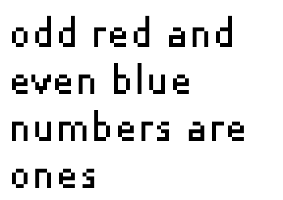
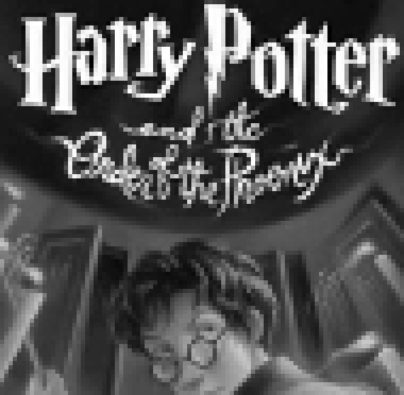

# xkcd.com/channel.html, decoded

## Note

From what I can find online[^1], previous people have determined that it carries information (follows Zipf's law), and is encoded in some weird way, but not more than that. Others[^2] tried to translate the Chinese to no avail.

Did I use AI? Yeah, I used AI. I still think it's worth reading. I might try to clean it up later. Feel free to submit a PR.

[^1]: https://www.explainxkcd.com/wiki/index.php/explain_xkcd:xkcd_explains , https://www.explainxkcd.com/wiki/index.php/Category:Extra_pages
[^2]: https://web.archive.org/web/20151206001238/http://forums.xkcd.com/viewtopic.php?f=2&t=110093

## Result

The page is a five-layer puzzle. Each layer hides the next, and three of them shout "red herring" along the way.

| Layer | Carrier | Hidden content |
|---|---|---|
| 1 | Chinese numerals on the page, one decimal byte per number | A 40×40 animated GIF of flashing red and blue Hebrew letters |
| 2 | Hebrew letters as numerals, one byte per burst of letters | A 72×51 GIF with the comment `redherring` ×6 |
| 3 | That GIF's picture | "odd red and even blue numbers are ones" |
| 4 | Letter color + odd/even byte, one bit per burst | "even financial and odd normal numerals = 1" |
| 5 | Numeral style + odd/even number, one bit per number on the page | A 95×93 grayscale GIF of the *Harry Potter and the Order of the Phoenix* cover, comment `REDHERRINGREDHERR` |

Layer 1 animation, layer 3 picture, layer 5 picture:

  

Whether there is a layer 6 is open.

Source: <https://web.archive.org/web/20141011002528/https://xkcd.com/channel.html> (`input/channel.html` and `input/channel.txt` are byte-identical). A 2014 forum post reports `Last-Modified: Sun, 15 Jan 2012` for both files, so the page likely dates from January 2012.

## Reproduce

Requires [`uv`](https://docs.astral.sh/uv/). Each script declares its own dependencies. Takes about 40 seconds.

```bash
./repro/run.sh            # writes to results/
./repro/run.sh /tmp/out   # or to any other folder
```

Run a single stage:

```bash
uv run --script repro/04_decode_color_parity.py results/
```

| Script | Layer | Input → output |
|---|---|---|
| `repro/01_decode_outer.py` | 1 | `channel.txt` → `decoded_fixed.gif` (1119 frames), `frames.npy`, `fixes.json`, `corrections.json`, `chain.json` |
| `repro/02_transcribe_frames.py` | 2 | `frames.npy` → `transcription_frames.tsv`, `seq.json`, `tokens.json`, `alts.json` |
| `repro/03_decode_inner.py` | 2–3 | `tokens.json` → `inner.gif`, `inner_x8.png`, `transcription_bytes.txt`, `inner_solutions.json`, `inner_candidates.png` |
| `repro/04_decode_color_parity.py` | 4 | `tokens.json` + `inner.gif` → `layer4_message.txt` |
| `repro/05_decode_numeral_forms.py` | 5 | `channel.txt` → `layer5.gif`, `layer5_x6.png` |

## Layout

| Path | Contents |
|---|---|
| `input/` | The original page (`channel.txt` = `channel.html`, sha256 `355d8e9e…0915`). |
| `repro/` | The pipeline: `run.sh` plus one script per stage. |
| `results/` | Output of `repro/run.sh`. |
| `exploration/` | The first session's working scripts and images (layers 1–2), kept for reference. They assume an old flat folder layout and will not run as-is. |

## Layer 1: page text → animated GIF

**How it works**
- The "garbled Chinese" is a list of decimal numbers 0–255, one per byte of a hidden file, separated by single low bytes (a space with ±1–2 of noise).
- Each digit is a Chinese numeral, in either the normal form (`〇一二三四五六七八九`) or the financial form (`零壹贰叁肆伍陆柒捌玖`). The form looks random here. It matters in layer 5.
- Every UTF-8 byte has ±1 noise. Decoding each 3-byte character to the nearest numeral recovers most digits. Two pairs stay confusable: 二/伍 (2/5) and 六/八 (6/8). The 2/5 mix-ups are silent, so every digit within the noise radius stays a candidate (3668 ambiguous bytes).
- The bytes start with `GIF89a`: a 40×40 animated GIF, 4-color palette, 1119 frames.
- `01_decode_outer.py` walks the GIF block structure. It backtracks over ambiguous bytes and accepts a frame only if its LZW data decodes exactly. Result: 2240 blocks, 1119 frames, 1106 byte repairs, and every frame loads in Pillow.
- A second pass makes 56 more corrections (`results/corrections.json`), each a 2↔5 or 6↔8 digit swap within the noise:
  - **Data (43 bytes, 19 frames):** the page's encoder is canonical greedy LZW, so re-encoding a frame's pixels must reproduce its bytes exactly. 18 frames didn't. Each has exactly one alternative reading that does, except frame 954, which has two (the script takes the one without a stray mark inside the ט). Frame 351 was canonical but garbled. Its one alternative canonical reading is a clean ח.
  - **Frame positions (13 bytes):** 12 frame tops were read as 2 instead of 5 and one left edge as 6 instead of 8. Each drew a letter a few pixels off, and the next blank frame didn't cover the leftover edges.
- After both passes, every frame is canonical, every frame is either blank or one clean letter, and each glyph is always drawn at the same spot.

**What didn't work, and the gotchas**
- A plain nearest-numeral decode (`exploration/1_outer_decode/decode.py`) breaks after a few frames.
- A greedy repair (`exploration/1_outer_decode/solve.py`) chose wrong digits early and could not recover. The backtracking solver replaced it.
- The encoder uses the classic deferred code-width increase. The end-of-data code can sit exactly at the last bit, so the decoder must allow zero-filled reads past the end.
- Validate each frame on a canvas the size of the frame. A full 40×40 canvas makes Pillow report the wrong pixel count.
- Where the GIF structure can't tell 2 from 5, the solver picks the lower digit. "Decodes exactly" is too weak a check: it let through the wrong readings above, which showed up as "static" in the animation. Some bytes have no check at all. The palette is probably white 255,255,255 and red 255,0,0, not the 255,225,255 and 252,0,0 in the output. That doesn't affect any later layer.

## Layer 2: Hebrew letters → second GIF

**How it works**
- Each frame is blank, one Hebrew letter, or the word `אפס` ("zero"). Letters are red or blue.
- `02_transcribe_frames.py` matches each frame against one clean example per glyph (±3 px shift; rewards covered template pixels, penalizes missing and extra ink). It knows 20 letters, א through ר, plus `אפס`. Every frame is read automatically, with no hand labels and no ambiguous letters.
- Blank frames separate bursts. There are **336 bursts**, and each one is a byte in Hebrew numerals: א=1 … ט=9, י=10 … צ=90, ק=100, ר=200, `אפס`=0. For example, `קיד` = 100+10+4 = 114 = `r`.
- The bytes form a GIF89a: 72×51, 2-color palette, comment `redherring` ×6, one image with a single 239-byte LZW chunk. The sizes add up to exactly 336 bytes, which confirms the burst count.

**What didn't work, and the gotchas**
- Shape clustering (`exploration/2_frame_reading/clusters*.png`) helped find the glyphs but mixed letters with static, so it couldn't serve as the transcription.
- A classifier without shift tolerance mislabeled frames (י vs. ט).
- Before the layer-1 corrections, the animation was full of "static": edges of letters drawn in the wrong place, or letters garbled by wrong data bytes. We first took it for a design feature. Working around it took 24 hand-labeled frames, four unreadable letters, and ט/ס and ה/ח candidate sets. Two misreads hid the picture for a long time: frame 403 (a garbled נ that looked like static; burst 128 is נה = 55) and frame 954 (ט read as ס; burst 288 is כט = 29). Both are among the 19 frames the canonical-LZW check fixes.

## Layer 3: the second GIF's picture

**How it works**
- The LZW data decodes with **no letter changes**, and only one stream is valid. `03_decode_inner.py` still runs a minimal-change search and checks that the stream is greedy (a greedy encoder never emits a code when a longer match is already in its dictionary), as a cross-check.
- The picture reads: **"odd red and / even blue / numbers are / ones"** (`results/inner_x8.png`).

**What didn't work**
- With the old transcription, the minimal-change search needed 2 changes and found 50 streams. All of them looked like random dots. That led to the wrong early conclusion that the picture was filler.
- Earlier decoders had bugs (bit accounting on the reset code, allowing palette indices 2–3 in a 2-color image). They produced plausible-looking but invalid images (`exploration/3_inner_decode/inner_idx.png` and similar).
- Blurring, dilating, other widths, transposing and periodicity checks on the wrong candidates found nothing, because there was nothing to find.

## Layer 4: letter color + odd/even

**How it works**
- One bit per burst: 1 if the byte is odd and the letters are red, or even and blue. Every burst is a single color.
- The 336 bits are 42 bytes of ASCII: **`even financial and odd normal numerals = 1`** (`results/layer4_message.txt`).

**What didn't work**
- Color on its own looks random: 167 of 336 bursts are red, with no structure in runs, autocorrelation or byte packings. It only carries data combined with odd/even.

## Layer 5: numeral style + odd/even

**How it works**
- One bit per number on the original page, from its **last** numeral: 1 if that digit is even and financial, or odd and normal.
- 73,808 numbers give exactly 9,226 bytes: a GIF89a, 95×93, 256-level grayscale palette, comment `REDHERRINGREDHERR`, showing the *Harry Potter and the Order of the Phoenix* cover (`results/layer5.gif`).
- It needs no repair. The noise confusions keep the bit: 二 (2, normal) and 伍 (5, financial) both give 0, and so do 六 and 八 (6 and 8, both normal). That looks deliberate.

**What didn't work**
- Taking the form from the **first** numeral gives the right header but a broken image. Repaired 2↔5 digits flip the parity bit. (The style never changes within a number: the 61 numbers that seem to mix styles are 伍 digits misread as 二.)
- Packing the forms of all numerals, or of the first or middle numeral, gives random-looking bits.

## Other dead ends

- **GIF metadata:** every frame of the layer-1 animation has the same delay (10) and disposal (1). There are no local palettes or interlacing. The only extensions are the standard loop block (count 0xFFFF) and a one-space comment. Frame rectangles are just the bounding boxes of changed pixels. Transparency is off, and the transparent-index byte (255 ×880, 225 ×113, 252 ×98, 222 ×28) is just 2/5 noise on 0xFF. Background index is 1. Palette entry 3 (black) is never used. Padding bits are zero, and nothing follows the trailer.
- **Timing and position:** every letter is shown for one frame, gaps are one frame, and each glyph is always drawn at the same spot.
- **GIF comments are length padding.** Each one makes its file a multiple of 8 bytes, so it fills whole bits in the next layer up. The layer-1 comment is the smallest that brings 73,803 bytes to 73,808. `redherring` ×6 brings layer 2 to 336 bytes (42 × 8, the length of the layer-4 message). The layer-5 comment brings 9,205 bytes to 73,808 / 8 = 9,226, which is why it stops at 17 characters.
- **The layer-5 GIF is ordinary encoder output.** netpbm's `ppmtogif` reproduces its LZW data byte for byte, and GraphicsMagick reproduces the whole file apart from two header details. Bit planes, palette steps, least-significant-bit statistics and enhanced views show nothing.
- **Noise:** the noise rate depends strongly on the byte value (about 0.5% for 0x8c, about 49% for 0x80). Given the value, it is independent of position, digit, style, parity and the layer-5 bit. No mechanism or message found.
- **Separators:** they average 32 but skew low (31: 28%, 32: 49%, 33: 20%, 34: 3.5%). Bit streams from separators, noise, style, parity, digit count and their XORs, at every offset and bit order, contain no file headers or English text.
- **Sibling hidden pages** (`cyborg.txt`, `me.txt`, `why.txt`) are unrelated.

## Open questions

- **Layer 6?** Every layer so far hid an instruction for the next. Nothing found in the layer-5 file, its pixels, or the page's leftover channels (see above).
- **Why Order of the Phoenix?** It is book 5, and this is layer 5. That may be a coincidence.
- **The January 2012 date** was the weekend of the MIT Mystery Hunt and right before the SOPA blackout. No connection has been found.
- A web search found no earlier published decode.
