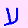

# xkcd.com/channel.html, decoded

## Note

From what I can find online[^1], previous people have determined that it carries information (follows Zipf's law), and is encoded in some weird way, but not more than that. Others[^2] tried to translate the Chinese to no avail.

Did I use AI? Yeah, I used AI. I still think it's valuable. I might try to clean it up later. Feel free to submit a PR.

[^1]: https://www.explainxkcd.com/wiki/index.php/explain_xkcd:xkcd_explains , https://www.explainxkcd.com/wiki/index.php/Category:Extra_pages
[^2]: https://web.archive.org/web/20151206001238/http://forums.xkcd.com/viewtopic.php?f=2&t=110093

## Result

The page hides a GIF animation of flashing Hebrew letters.



Read as Hebrew numerals, the letters spell out a second, tiny GIF. That GIF's text comment is:

```
redherringredherringredherringredherringredherringredherring
```

The 72×51 picture inside the second GIF could not be recovered unambiguously. Every candidate looks like scattered dots.

My guess is that this was part of some sort of bigger elaborate puzzle, and that this was a red herring. Or maybe this is a red herring to waste explainxkcd's time ;)


Source: <https://web.archive.org/web/20141011002528/https://xkcd.com/channel.html> (`input/channel.html` and `input/channel.txt` are byte-identical).

## Layout

| Path | Contents |
|---|---|
| `input/` | The original page (`channel.txt` = `channel.html`, sha256 `355d8e9e…0915`). |
| `repro/` | Clean pipeline: `run.sh` plus three stage scripts. |
| `results/` | Output of `repro/run.sh`. These are the final artifacts. |
| `exploration/` | Original working scripts and images, kept for reference. These scripts assume the old flat folder layout and will not run as-is. |

## Reproduce

Requires [`uv`](https://docs.astral.sh/uv/). Takes about 40 seconds.

```bash
./repro/run.sh            # writes to results/
./repro/run.sh /tmp/out   # or to any other folder
```

| Script | Input → output |
|---|---|
| `repro/01_decode_outer.py` | `channel.txt` → `decoded_fixed.gif` (1119 frames), `frames.npy`, `fixes.json`, `chain.json` |
| `repro/02_transcribe_frames.py` | `frames.npy` → `transcription_frames.tsv`, `seq.json`, `tokens.json`, `alts.json` |
| `repro/03_decode_inner.py` | `tokens.json` → `inner.gif`, `transcription_bytes.txt`, `inner_candidates.png`, `inner_solutions.json` |

The pipeline output matches the exploration files byte for byte, except for the inner picture data, where the repair is ambiguous (see below).

## Layer 1: page text → outer GIF

**What worked**
- The "garbled Chinese" text is a list of decimal numbers 0–255, one per byte of a hidden file.
- Each digit is a Chinese numeral. Both the common forms (`〇一二三四五六七八九`) and the financial forms (`零壹贰叁肆伍陆柒捌玖`) are used. Numbers are separated by single-byte punctuation.
- The UTF-8 bytes of the numerals have random low-bit flips. Decoding each 3-byte character to the nearest numeral recovers most digits. Two pairs stay confusable: 6/8 (六/八) and 2/5 (二/伍). The 2/5 mix-ups are silent, so a nearest match alone is not enough. Every digit within the noise radius stays a candidate (3668 ambiguous bytes).
- The first bytes are `GIF89a`. The file is a 40×40 animated GIF with a 4-color palette and 1119 frames.
- `01_decode_outer.py` walks the GIF block structure. It backtracks over ambiguous bytes and accepts a frame only if its LZW data decodes exactly. Result: 2240 blocks, 1119 frames, 1106 byte repairs, and every frame loads in Pillow.

**What didn't work, and the gotchas**
- A plain nearest-numeral decode (`exploration/1_outer_decode/decode.py` → `decoded.gif`) gives a GIF that breaks after the first few frames.
- A greedy repair (`exploration/1_outer_decode/solve.py`) chose wrong digits early and could not recover. It was replaced by the backtracking solver (`solve2.py`, now `repro/01_decode_outer.py`).
- The encoder uses the classic deferred code-width increase. The end-of-data code can sit exactly at the last bit, so the decoder must allow zero-filled reads past the end.
- When validating a frame, the canvas must be sized to the frame. Using the full 40×40 canvas makes Pillow report the wrong pixel count.

## Layer 2: frames → Hebrew letters

**What worked**
- Each frame is one of: blank, static/remnant bars, one letter, or a multi-letter word. Letters are red or blue.
- `02_transcribe_frames.py` matches each frame against one clean example frame per glyph. Matching allows ±3 px of shift, rewards template pixels that are covered, and penalizes both missing and extra ink.
- 21 glyphs: א ב ג ד ה ו ז ח ט י כ ל מ נ ס ע פ צ ק ר, plus the word `אפס` ("zero").
- 23 frames where static covers the letter were labeled by eye (the `MANUAL` table). Four of them are unreadable (`?`).
- A blank frame separates bursts. The result is **336 letter bursts**; `results/transcription_frames.tsv` lists every frame.

**What didn't work, and the gotchas**
- Clustering frames by shape (`exploration/2_frame_reading/clusters*.png`) helped identify the glyphs. Its clusters mixed letters with static and half-drawn frames, so it could not be used directly as the transcription.
- An early mask bug (checking colors on the wrong array axis) produced garbage masks.
- A first template classifier (`classify.py`) without shift tolerance mislabeled several frames (for example, י vs. ט).
- Confusable glyphs remain where static overlaps: ט vs. ס (34 frames) and ה vs. ח. These become candidate sets for the next stage instead of fixed labels.
- Red vs. blue: every readable byte came out correctly without using color, so color appears to be decoration. I did not test whether the colors carry a separate signal.

## Layer 3: Hebrew numerals → inner GIF

**What worked**
- Each burst is one byte, using standard Hebrew numerals (gematria): א=1 … ט=9, י=10 … צ=90, ק=100, ר=200, and `אפס` = 0. For example, `קיד` = 100+10+4 = 114 = `r`.
- The bytes form a valid GIF file:
  - `GIF89a`, 72×51 pixels, 2-color palette (white, black).
  - A comment block of 60 characters: `redherring` ×6.
  - An image block with LZW minimum code size 2, a single 239-byte data chunk, then the terminator and the `;` trailer.
- The sizes match the burst count exactly (95 header bytes + 239 data bytes + 2 = 336). This confirms the burst segmentation.
- Burst 44 is unreadable, but it sits inside the 6th `redherring`, so it must be `d` (100).

**What didn't work**
- The raw picture data fails LZW decoding at burst 113, which contains an unreadable letter.
- `03_decode_inner.py` searches for the fewest letter changes that make the data decode strictly. Changes are limited to confusable alternatives; unreadable letters may be any value. No solution needs 0 or 1 changes. **50 different solutions need 2 changes**, and each yields a different picture (`results/inner_candidates.png`). All of them look like sparse random dots. `results/inner.gif` is just the first candidate.
- Earlier repair attempts (`exploration/3_inner_decode/repair_inner.py`) had two decoder bugs: wrong bit accounting on the reset code, and allowing palette indices 2–3 in a 2-color image. These produced plausible-looking but invalid pictures (`inner_idx.png`, `inner_dil.png`, `inner_blur.png`). Treat those images as invalid.
- Blurring, dilating, and checking periodicity of the dot pattern showed no hidden text or drawing.

## Interpretation

- The hidden message is "red herring", a joke at the solver's expense after three layers of encoding.
- The picture is probably filler. The compressed size (239 bytes for 173 black pixels out of 3672) fits random sparse dots, not a clean drawing. This is an inference, not a proof.
- A web search found no prior published decode. 

## Key artifacts

- `results/transcription_frames.tsv`: all 1119 frames (blank / static / letter + color).
- `results/transcription_bytes.txt`: all 336 bursts → letters, colors, byte value, character, and repair notes.
- `results/decoded_fixed.gif`: the repaired outer animation.
- `results/inner.gif`: the inner GIF (header and comment are certain; picture data is one of 50 candidates).
- `exploration/2_frame_reading/seq_*.png`, `detail_*.png`: montages used to read letters by eye.
